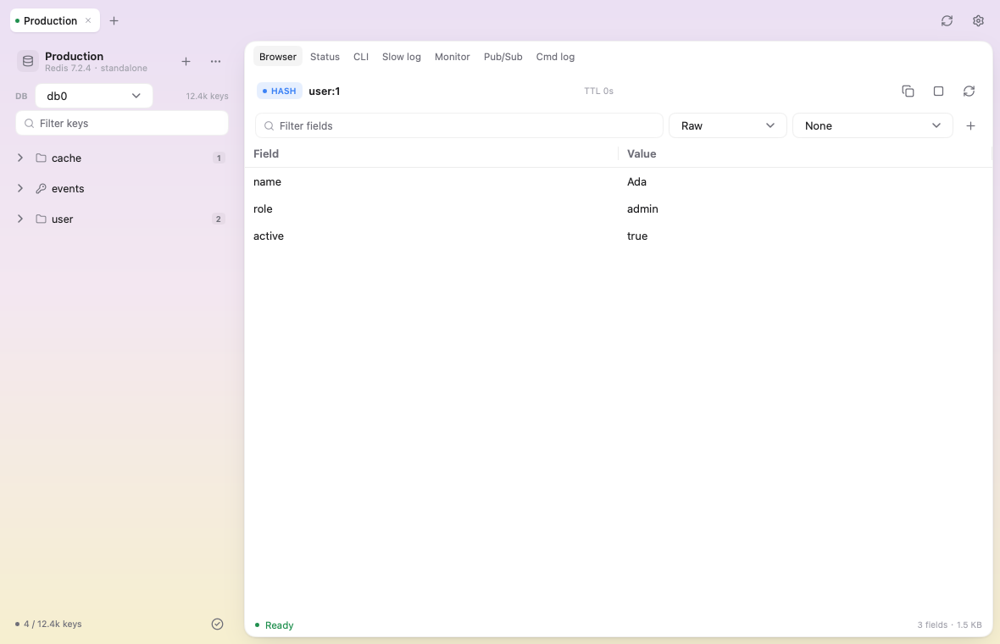

<p align="center">
  
</p>

# Kivrix

[English](README.md) · [简体中文](README.zh-CN.md)

**A cross-platform native Redis desktop client built with Go and MyGo,
with a self-rendered UI and no Electron or WebView.**

Kivrix is pronounced **KIV-riks** /ˈkɪv.rɪks/, with stress on the first syllable.
The name combines **Kiv**, a lighter take on *key*, with **rix**, inspired by
*matrix* and *vertex*: a lightweight, fast view of key-value data.

Kivrix is a desktop GUI for browsing and operating Redis, Sentinel and
Redis Cluster servers. It runs as a single native executable on macOS,
Windows and Linux. [MyGo](https://github.com/egoist/mygo) provides native
windows and system integration, while its `ui` package draws the application's
buttons, tables and editors. On macOS, the window uses AppKit and the UI
supports Metal acceleration. Kivrix does not require cgo.

Kivrix's feature design and workflows draw primarily on
[Tiny RDM](https://github.com/tiny-craft/tiny-rdm). Its overall interface design
and interactions draw primarily on [kero](https://github.com/egoist/kero),
with some layout and control code adapted from kero. We thank the authors
and contributors of both projects. See [Acknowledgements and licensing](#acknowledgements-and-licensing)
for attribution and license details.



## Code layout

```text
cmd/kivrix/       thin process entry point
internal/app/     MyGo app state, sessions, views and feature code
internal/secrets/ AES-GCM local password vault
resources/        icons and packaged licenses
docs/             feature, parity and release documentation
scripts/          integration and packaging helpers
```

`internal/secrets` is the first extracted domain package. `internal/app`
is intentionally one package while the UI, session and Redis layers are
still tightly coupled; smaller `internal/redis` and `internal/preferences`
packages can follow without changing the binary.

## Highlights

- **Connections** — standalone, Sentinel and Cluster; TLS, HTTP/SOCKS5
  proxies, SSH tunnels; connection groups, import/export and a test-connection
  button.
- **Key browser** — automatic, batched key loading into a namespace tree, check mode and batch
  actions, auto refresh, full-value copy and fullscreen.
- **Values** — string, hash, list, set, sorted set, stream and RedisJSON;
  row editing, stream consumer groups and pending entries, ACK/claim and
  XTRIM.
- **Formats and decoders** — Raw, JSON, YAML, XML, Hex, Binary, BitSet;
  Base64/GZip/Zstd/LZ4/Brotli/Msgpack/PHP/Pickle/Hex/URL decoding, plus
  named custom decoder and encoder commands.
- **Operations** — Status with sampled charts, client list, CLI, slow log,
  Monitor, Pub/Sub and an in-app command log.
- **CSV** — import and export with overwrite/TTL options, progress and cancellation.
- **Safer editing** — unsaved-change protection, environment badges, read-only
  connections and explicit confirmation for bulk deletion.
- **Navigation** — a resizable sidebar and command-palette search for connections
  and recent keys.
- **Desktop integration** — native settings window, English and Simplified
  Chinese, command palette, keyboard shortcuts, GitHub release updates, and
  a startup choice between the connection list and the last session/DB.
- **Security-minded** — passwords never enter `profiles.json`; they are kept
  in an AES-GCM encrypted local vault with `0600` files. No telemetry.

See the [feature reference](docs/FEATURES.md) and the
[parity matrix](PARITY.md) for details and known gaps.

## Built with

| Component | Role |
|---|---|
| [Go 1.27](https://go.dev/) | Language and standard library |
| [MyGo 0.6.2](https://github.com/egoist/mygo) | Self-rendered UI, native windows, packaging and app runtime |
| [go-redis 9](https://github.com/redis/go-redis) | Redis client, Sentinel and Cluster support |
| [miniredis](https://github.com/alicebob/miniredis) | In-process Redis for tests |
| [Lucide](https://lucide.dev/) | Interface icons |

Decoders use `klauspost/compress` (Zstandard), `pierrec/lz4`,
`andybalholm/brotli`, `vmihailenco/msgpack`, `phpserialize`, `gopickle` and
`yaml.v3`. SSH support uses `golang.org/x/crypto`.

Kivrix does not embed a browser engine and does not require cgo. The
architecture, lifetime rules and UI patterns are documented in the source;
`docs/RELEASING.md` covers packaging and signing.

## Install

Download a build from the [GitHub Releases](https://github.com/cuikaipeng/kivrix/releases)
page:

- macOS: `.dmg` (universal)
- Windows: NSIS `Setup .exe`
- Linux: `.deb`, or download both the matching `.tar.gz` and `install.sh`

> **Signing status:** builds require no signing certificates. macOS packages
> use ad-hoc signing without Apple notarization; Windows installers are unsigned.
> macOS may require **System Settings → Privacy & Security → Open Anyway**;
> Windows may show a SmartScreen warning. Some device policies and Smart App
> Control can block unsigned apps. See the [installation notes](docs/RELEASING.md#install-without-certificates)
> and checksums in the release guide.

### macOS first launch

First drag `Kivrix.app` from the DMG into **Applications**. If macOS blocks
the first launch and you trust the download, you can remove the app's download
quarantine attribute in Terminal:

```sh
xattr -dr com.apple.quarantine "/Applications/Kivrix.app"
```

Then open Kivrix again. If the command reports a permission error, prefix it
with `sudo`. This addresses quarantine-related blocking; it does not repair
corrupted files or invalid code signatures.

### Updates

Kivrix checks for new versions at startup by default. A new release appears
at the top right of the main window; manual checks are also available in
General settings and the top-left menu. Click **Download update**, then
**Install and restart** when it is ready. Unsaved edits are protected before
restarting. Updates are verified and prepared in the app's installation
directory; there is no installer to run manually.

The installed app must be in a writable location. Linux DEB installations
are updated through the package manager; tarball installations support
in-app updates. The startup check can be disabled in settings.

### Build from source

Requirements: Go 1.27+, Python 3.9+ for packaging, and `redis-server`/`redis-cli`
only if you want to run the integration tests.

```sh
git clone https://github.com/cuikaipeng/kivrix
cd kivrix
go tool mygo dev        # run with live reload
make package            # requires the update-signing key; outputs build/release/
```

Packaging needs the free update-signing key described in the
[release guide](docs/RELEASING.md#update-signing-key), but no OS signing certificate.

Useful commands:

```sh
go test -count=1 ./...
go test -race -count=1 ./...
go vet ./...
go tool mygo vet ./internal/app
./scripts/integration.sh   # real standalone, Sentinel and 3-node Cluster
```

CI builds macOS, Linux and Windows artifacts; see
[`.github/workflows/build.yml`](.github/workflows/build.yml) and
[releasing instructions](docs/RELEASING.md).

## Password storage and privacy

- Passwords are stored in an encrypted local vault: `secrets.vault` and
  `secrets.key`, using AES-GCM. They use `0600` permissions on macOS/Linux;
  Windows inherits the user-data directory's access controls. The protection
  boundary is the current operating-system user's file permissions; Kivrix
  does not use the macOS Keychain. Exports in shared Windows directories
  inherit those directories' access controls too.
- `profiles.json` never contains passwords.
- There is no telemetry or analytics. Network access is limited to the Redis
  servers/proxies/SSH hosts you configure, plus the GitHub release check when
  enabled.
- Update archives require a valid Ed25519 signature of their SHA-256 digest
  before replacing app files; HTTPS redirects cannot downgrade to HTTP.
- Authentication and password-setting commands are redacted before entering
  command logs and excluded from CLI history. Other Redis values, Monitor
  output and exports may still contain sensitive application data. Exported
  profiles omit passwords but retain addresses, usernames and local paths.

Resource safeguards limit a Redis reply to 16 MiB, 100,000 elements and 64
nesting levels before allocating its contents. The browser retains at most
50,000 keys within a 16 MiB estimated tree budget. Key lists load automatically
on connection, database changes and filtering; scanning can be canceled, and
reaching either limit prompts a narrower filter. Editable text is limited
to 1 MiB; loaded collections to 8 MiB or 10,000 rows. Oversized values are
never saved as truncated data; oversized strings offer a read-only 64 KiB
preview. CSV export is also subject to
the reply limit.

Live displays render only visible rows and update in batches at most ten
times per second, with a bounded backlog. Each event retains at most 4 KiB;
live row previews show up to 512 bytes, with longer retained text available
in tooltips and exports. Monitor/Pub/Sub stop above 4,096 messages or 4 MiB per second.
Minimizing pauses automatic value refresh and stops live feeds; closing the
window cancels work and closes Redis/SSH connections.

Custom decoder/encoder commands receive values through stdin, never
`{VALUE}` arguments. They have a ten-second timeout, an 8 MiB output limit
and a two-process concurrency limit. They are **not sandboxed**: run only
programs you trust, which can still access files/network and consume system
resources. These safeguards bound individual operations, not total process
RAM or CPU/GPU usage across all sessions.

## Compatibility

- Redis 4 or newer (`UNLINK` is used for deletes).
- RedisJSON is optional; JSON keys use `JSON.GET`/`JSON.SET` when the module
  is loaded.
- Redis Cluster supports key scanning, cross-slot delete/rename and Flush DB;
  Status/Slow log/Monitor read one node.
- Desktop only. A Web/Docker edition is intentionally out of scope.

## Documentation

- [Feature reference](docs/FEATURES.md)
- [Tiny RDM parity matrix](PARITY.md)
- [Building, signing and releasing](docs/RELEASING.md)
- [Third-party notices](THIRD_PARTY_NOTICES.md)
- [MIT license](LICENSE)
- [Contributing](CONTRIBUTING.md)

## How this was built

Kivrix is developed with heavy AI assistance under human direction.
A human maintains the product scope, reviews the code, runs the tests,
checks third-party licenses, and owns release decisions. AI-generated
code can contain mistakes; please report issues.

## Acknowledgements and licensing

Kivrix is **not affiliated with Redis Ltd., Tiny RDM, or kero**.

- **[MyGo](https://github.com/egoist/mygo)** — MIT licensed native UI
  framework, Copyright (c) 2026 MyGo contributors.
- **[kero](https://github.com/egoist/kero)** — MIT licensed, Copyright (c)
  2026 EGOIST. Kivrix's visual language and some settings/control code
  are adapted from kero; the MIT notice is retained in
  [`third_party/licenses/kero.txt`](third_party/licenses/kero.txt).
- **[Tiny RDM](https://github.com/tiny-craft/tiny-rdm)** — GPL-3.0. Used
  **only as a product/feature and UX reference**. No Tiny RDM source code,
  translations, themes, images or other assets are included. Kivrix is
  an independent implementation. Do not contribute GPL code or assets to
  this repository unless you intend to relicense the project consistently.
- **Icons** — [Lucide](https://lucide.dev/), ISC licensed, with MIT notices
  for Feather-derived icons. See
  [`third_party/licenses/lucide.txt`](third_party/licenses/lucide.txt).
- Go dependencies retain their upstream licenses; see
  [THIRD_PARTY_NOTICES.md](THIRD_PARTY_NOTICES.md) and
  [`third_party/licenses/`](third_party/licenses/).

Kivrix is released under the [MIT License](LICENSE). By contributing,
you agree that your contribution is licensed under the same MIT terms. Keep
the copyright and license notices when redistributing the app or a modified
version. Third-party components retain their own licenses. The
[open-source audit record](docs/OPEN_SOURCE_AUDIT.md) describes the checked
versions, reference projects, remaining limits and automated notice checks.

Redis and RedisJSON are trademarks of Redis Ltd. Other names are trademarks
of their respective owners.
