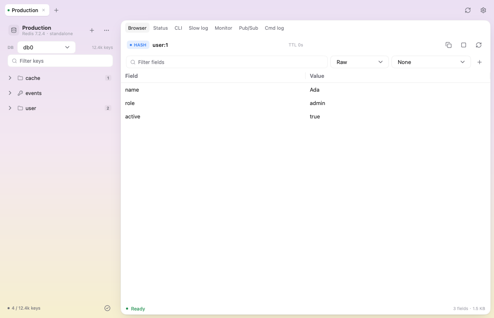

<p align="center">
  
</p>

# Kivrix

[English](README.md) · [简体中文](README.zh-CN.md)

**使用 Go 和 MyGo 构建的跨平台原生 Redis 桌面客户端，采用自绘界面，
不使用 Electron 或 WebView。**

Kivrix 读作 **kiv-riks**，音标为 **/ˈkɪv.rɪks/**，重音在第一音节。
名字由 **Kiv**（*key* 的轻写）与 **rix**（取意于 *matrix* / *vertex*）构成，
寓意是：把 key-value 数据放在一个轻量、快速的视图里。

Kivrix 用来浏览和操作 Redis、Sentinel 与 Redis Cluster，在 macOS、
Windows、Linux 上以单个原生可执行程序运行。
[MyGo](https://github.com/egoist/mygo) 提供原生窗口和系统集成，按钮、
表格、编辑器等控件由它的 `ui` 包自行绘制。macOS 下使用 AppKit 窗口，
界面支持 Metal 加速。项目不依赖 cgo。

Kivrix 的功能设计与使用流程主要参考 [Tiny RDM](https://github.com/tiny-craft/tiny-rdm)，
整体界面设计与交互主要借鉴 [kero](https://github.com/egoist/kero)，
并改编了 kero 的部分布局和控件代码。感谢两个项目的作者和贡献者。
具体来源与许可证说明见[致谢与开源合规](#致谢与开源合规)。



## 目录结构

```text
cmd/kivrix/       进程入口
internal/app/     MyGo 应用状态、会话、视图与功能代码
internal/secrets/ AES-GCM 本地密码库
resources/        图标和随包分发的许可证
docs/             功能、兼容性矩阵和发布文档
scripts/          集成测试与打包脚本
```

`internal/secrets` 是第一个拆出的领域包。目前 `internal/app` 仍是一个包，
因为 UI、会话和 Redis 层耦合较紧；后续可以在不改二进制行为的情况下继续
拆出 `internal/redis`、`internal/preferences`。

## 主要功能

- **连接**：Standalone、Sentinel、Cluster；TLS、HTTP/SOCKS5 代理、SSH
  隧道；连接分组、导入导出、测试连接。
- **Key 浏览**：自动分批加载全部 key、命名空间树、Check mode 批量操作、自动刷新、
  复制完整值和全屏查看。
- **值编辑**：string、hash、list、set、zset、stream、RedisJSON；行编辑、
  Stream 消费者组和 pending 条目、ACK/Claim、XTRIM。
- **格式与解码**：Raw、JSON、YAML、XML、Hex、Binary、BitSet；
  Base64/GZip/Zstd/LZ4/Brotli/Msgpack/PHP/Pickle/Hex/URL 解码；支持命名
  自定义解码器和编码器命令。
- **运维工具**：Status 与采样图表、客户端列表、CLI、慢日志、Monitor、
  Pub/Sub、命令日志。
- **CSV**：导入导出，支持覆盖策略、TTL、进度和取消。
- **编辑保护**：未保存修改提醒、环境标识、只读连接，以及批量删除的明确确认。
- **导航**：侧栏可调宽度、可折叠；命令面板支持搜索连接和最近访问的键。
- **桌面体验**：原生设置窗口、英文/简体中文、命令面板、快捷键、GitHub
  版本更新检查；启动时可选择连接列表或上次的 profile/DB。
- **安全**：密码不写入 `profiles.json`，保存在 AES-GCM 加密的本地库中，
  文件权限 `0600`；没有遥测。

更完整的说明见[功能参考](docs/FEATURES.md)和
[功能矩阵](PARITY.md)。

## 技术栈

| 组件 | 用途 |
|---|---|
| [Go 1.27](https://go.dev/) | 语言与标准库 |
| [MyGo 0.6.2](https://github.com/egoist/mygo) | 自绘 UI、原生窗口、打包与运行时 |
| [go-redis 9](https://github.com/redis/go-redis) | Redis 客户端、Sentinel、Cluster |
| [miniredis](https://github.com/alicebob/miniredis) | 测试用内存 Redis |
| [Lucide](https://lucide.dev/) | 界面图标 |

解码器使用 `klauspost/compress`（Zstandard）、`pierrec/lz4`、
`andybalholm/brotli`、`vmihailenco/msgpack`、`phpserialize`、`gopickle`
和 `yaml.v3`；SSH 使用 `golang.org/x/crypto`。

项目不使用浏览器内核，不依赖 cgo。打包和签名见
[发布说明](docs/RELEASING.md)。

## 安装

从 [GitHub Releases](https://github.com/cuikaipeng/kivrix/releases)
下载：

- macOS：`.dmg`（universal）
- Windows：NSIS `Setup .exe`
- Linux：`.deb`，或同时下载对应架构的 `.tar.gz` 和 `install.sh`

> **签名说明：** 构建和发版均无需签名证书。macOS 使用 ad-hoc 签名，未经
> Apple 公证；Windows 安装包未签名。macOS 首次打开可能需要在
> **系统设置 → 隐私与安全性 → 仍要打开** 中确认；Windows 可能出现
> SmartScreen 提示。部分设备策略和智能应用控制可能阻止运行。
> 安装步骤和校验和说明见[发布说明](docs/RELEASING.md#install-without-certificates)。

### macOS 首次打开

先将 DMG 中的 `Kivrix.app` 拖入**应用程序**。如果首次打开被 macOS 拦截，
且你确认安装包来源可信，可以在终端中执行以下命令，清除该应用的下载隔离标记：

```sh
xattr -dr com.apple.quarantine "/Applications/Kivrix.app"
```

然后重新打开 Kivrix。如果命令提示权限不足，可以在前面加 `sudo`。
这能处理隔离标记导致的启动拦截，但无法修复真正损坏的文件或无效的代码签名。

### 应用内更新

默认在启动时检查新版本，发现新版后会在主窗口右上角提示。也可以通过
**设置 → 通用**、左上角菜单或系统应用菜单手动检查。
点击**下载更新**后，应用会自动下载、校验并准备更新，完成后显示
**安装并重启**；重启前会提醒保存未完成的编辑，无需另行操作安装文件。

正式版需要安装在当前用户可写的位置。Linux DEB 安装请通过软件包管理器
更新；tarball 安装支持应用内更新。可在设置中关闭启动检查。

### 从源码构建

需要 Go 1.27+，打包需要 Python 3.9+；只有跑集成测试时才需要
`redis-server` 和 `redis-cli`。

```sh
git clone https://github.com/cuikaipeng/kivrix
cd kivrix
go tool mygo dev        # 开发模式，热重载
make package            # 需配置更新签名密钥，安装包输出到 build/release/
```

打包需要配置免费的更新签名密钥，见[发布说明](docs/RELEASING.md#update-signing-key)，
无需申请 Apple 或 Microsoft 的系统签名证书。

常用命令：

```sh
go test -count=1 ./...
go test -race -count=1 ./...
go vet ./...
go tool mygo vet ./internal/app
./scripts/integration.sh   # 真实 Standalone、Sentinel、3 节点 Cluster
```

三平台 CI 见 [`.github/workflows/build.yml`](.github/workflows/build.yml)，
发布流程见[发布说明](docs/RELEASING.md)。

## 密码与隐私

- 密码保存在 AES-GCM 本地加密库：`secrets.vault` 和 `secrets.key`。
  macOS/Linux 权限为 `0600`；Windows 继承用户数据目录的访问控制。
  安全边界是当前操作系统用户的文件权限；不使用 macOS 钥匙串。
  Windows 上导出到共享目录的文件也会继承该目录的访问控制。
- `profiles.json` 永远不包含密码。
- 没有遥测或统计。网络访问只连接你配置的 Redis/代理/SSH 主机，以及在
  开启时访问 GitHub Release。
- 更新包通过内置公钥验证 SHA-256 摘要的 Ed25519 签名后才会替换应用文件，
  HTTPS 下载重定向不能降级到 HTTP。
- 认证、设置密码等敏感命令在进入命令日志前脱敏，并排除在 CLI 历史之外。
  其他 Redis 值、Monitor 输出和导出文件仍可能包含业务敏感数据；连接导出
  不包含密码，但保留地址、用户名及本地文件路径。

资源保护会在分配内容内存前限制单个 Redis 回复：16 MiB、10 万个元素、
64 层嵌套。浏览器最多保留 5 万个 key，并限制键树的估算内存为 16 MiB；
连接、切换数据库和筛选后会自动分批加载 key 列表，可随时取消；达到上述
任一上限会停止并提示缩小筛选范围。可编辑文本最多 1 MiB，已加载集合
最多 8 MiB 或 1 万行。超限会报错，不会
把截断后的内容保存回 Redis。超大字符串可只读预览前 64 KiB；CSV 导出也受单个回复上限约束。

实时列表只渲染可见行，每秒最多批量刷新 10 次，待处理队列有界。每条实时
文本最多保留 4 KiB，行预览最多显示 512 字节，其余已保留文本可通过悬停
提示或导出查看。Monitor/Pub/Sub 每秒
超过 4096 条消息或 4 MiB 时会停止并提示。最小化窗口会暂停自动值刷新、
停止实时订阅；关闭窗口会取消任务并关闭 Redis/SSH 连接。

自定义解码器/编码器通过标准输入接收值，不再支持 `{VALUE}` 参数替换。
执行限时 10 秒、输出上限 8 MiB，同时最多运行两个程序。它们**没有系统
沙箱隔离**，仍能读写文件、访问网络和消耗系统资源，请只运行信任的程序。
上述保护限制单项操作，不是整个应用及所有会话的 CPU、GPU 或内存硬配额。

## 兼容性与限制

- 需要 Redis 4 或更高版本（删除使用 `UNLINK`）。
- RedisJSON 是可选的；加载模块后支持 JSON key 的读取和保存。
- Redis Cluster 支持 key 扫描、跨 slot 删除/重命名和 Flush DB；
  Status/慢日志/Monitor 只读取一个节点。
- 仅提供桌面版，不提供 Web/Docker 版本。

## 文档

- [功能参考](docs/FEATURES.md)
- [Tiny RDM 功能矩阵](PARITY.md)
- [构建、签名与发布](docs/RELEASING.md)
- [第三方声明](THIRD_PARTY_NOTICES.md)
- [MIT 许可证](LICENSE)
- [参与贡献](CONTRIBUTING.md)

## 开发说明

本项目在人类主导下大量使用 AI 编程助手完成。需求、代码审查、测试、
第三方许可证核对和发布决策由维护者负责。AI 生成的代码仍可能存在错误，
欢迎提交 issue。

## 致谢与开源合规

Kivrix 与 Redis Ltd.、Tiny RDM、kero 均无隶属关系。

- **[MyGo](https://github.com/egoist/mygo)**：MIT，Copyright (c) 2026
  MyGo contributors，原生 UI 框架。
- **[kero](https://github.com/egoist/kero)**：MIT，Copyright (c) 2026
  EGOIST。Kivrix 的视觉语言和部分设置/控件实现参考并改编自 kero；
  MIT 声明保留在
  [`third_party/licenses/kero.txt`](third_party/licenses/kero.txt)。
- **[Tiny RDM](https://github.com/tiny-craft/tiny-rdm)**：GPL-3.0。仅作为
  产品、功能和 UX 参考，**没有复制 Tiny RDM 的源码、翻译、主题、图片或
  其他素材**；Kivrix 是独立实现。请不要向本仓库提交来自 Tiny RDM
  或其他 GPL 项目的代码/素材，除非准备把项目整体改为相应许可证。
- **图标**：[Lucide](https://lucide.dev/)，ISC 许可，源自 Feather 的图标还保留 MIT 声明；见
  [`third_party/licenses/lucide.txt`](third_party/licenses/lucide.txt)。
- 依赖保留各自的许可证，根目录 MIT 协议不替代第三方条款。
  检查范围、参考项目和后续维护方法见[开源审查记录](docs/OPEN_SOURCE_AUDIT.md)。
- Go 依赖保留各自上游许可证，详见
  [THIRD_PARTY_NOTICES.md](THIRD_PARTY_NOTICES.md) 和
  [`third_party/licenses/`](third_party/licenses/)。

Kivrix 以 [MIT License](LICENSE) 开源。提交贡献即表示同意以相同
MIT 条款授权。分发应用或修改版时请保留版权和许可证声明。

Redis 和 RedisJSON 是 Redis Ltd. 的商标；其他名称归各自权利人所有。
